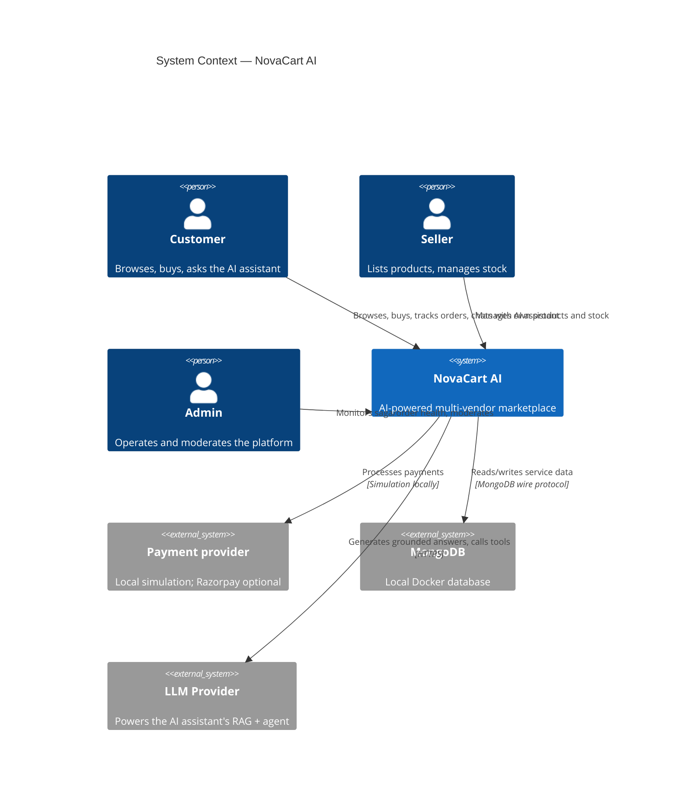

# NovaCart AI

**The Future of Intelligent Shopping**

A cloud-native, event-driven, AI-powered e-commerce platform built on Service-Oriented Architecture and microservices — where an AI agent grounded in real catalogue and policy data can search, compare, recommend, and act on a customer's behalf.

Built as a 4-person team project, each member independently owning a vertical slice of the system (see [Team & Ownership](#team--ownership)).

## Team Members

| Roll Number | Name |
|---|---|
| 2410030208 | N Hemanth Babu (Lead) |
| 2410030048 | Alok Kumar Singh |
| 2410030110 | Smruti Ranjan Parhi |
| 2410030114 | Arjun |

---

## What makes this worth looking at

Three things this project is actually trying to prove, not just describe:

1. **Real event-driven consistency** — the order flow is a genuine Saga with compensating transactions and a transactional outbox, not just "service A calls service B."
2. **Grounded RAG with measurable checks** — retrieval-augmented answers with citations, refusal rules, and an evaluation harness.
3. **A tool-calling AI agent with a real permission model** — the agent can *act* (cancel an order, check stock), fenced against prompt injection and privilege escalation, with every write confirmed before it executes.

## Status

The full local stack runs through Docker Compose. See [`docs/PROGRESS.md`](docs/PROGRESS.md) for phase history and [`docs/REVIEW_RUNBOOK.md`](docs/REVIEW_RUNBOOK.md) for a verified review sequence.

| Area | Status |
|---|---|
| Requirements, architecture, database design, design system | ✅ Done |
| Frontend storefront, account, checkout, seller, and AI pages | ✅ Done |
| Platform infra — Eureka, Config Server, API Gateway | ✅ Done |
| Auth service — register/login/refresh/logout/reset, RS256 JWT, rate limiting | ✅ Done |
| Product, Inventory, Cart, Order, Payment, Kafka saga, AI Assistant | ✅ Running locally |
| Docker Compose | ✅ Running locally |
| Full CI/CD and cloud deployment | Deferred |

The local checkout uses payment simulation; real payment credentials and public deployment are outside the review scope. See [`docs/DEFERRED.md`](docs/DEFERRED.md) for the remaining work.

## Architecture

Full detail, C4 diagrams, service boundary reasoning, and the saga sequence diagram live in [`docs/ARCHITECTURE.md`](docs/ARCHITECTURE.md). High-level system context:



## Tech Stack

| Layer | Stack |
|---|---|
| Backend | Java 21, Spring Boot 3.3.13, Spring Cloud 2023.0.6, Spring Security, Spring Data MongoDB, Maven (multi-module, wrapper committed) |
| Frontend | React 19, TypeScript 6, Vite 8, Tailwind CSS 3, React Router 6, TanStack Query 5, Zustand, Framer Motion, react-hook-form + Zod |
| Data | MongoDB, PostgreSQL, Redis |
| Infra | Eureka (discovery), Spring Cloud Config (centralized config, native/filesystem-backed), Spring Cloud Gateway (edge) |
| Auth | RS256 JWT, opaque hashed refresh tokens with rotation + reuse detection, BCrypt-12 |
| Commerce and AI | Kafka saga, local payment simulation (optional Razorpay integration), Gemini-backed RAG, Docker Compose |
| Deferred | Public cloud deployment, real email delivery, full CI/CD |

## Repository Structure

```
novacart-ai/
├── docs/                    # requirements, architecture, database design, decisions, progress
├── infra/
│   ├── eureka-server/
│   ├── config-server/
│   └── api-gateway/
├── services/
│   ├── auth-service/
│   ├── product-service/     # catalogue and reviews
│   ├── inventory-service/
│   ├── cart-service/
│   ├── order-service/
│   ├── payment-service/
│   ├── notification-service/
│   └── ai-assistant-service/
├── shared/
│   └── novacart-common/     # event envelope + API response DTOs only, no business logic
├── frontend/
│   └── novacart-web/
├── keys/                    # gitignored — RS256 JWT keypair, generate your own (see below)
├── pom.xml                  # Maven multi-module parent
├── mvnw / mvnw.cmd          # Maven Wrapper — no system-wide Maven install needed
└── .env.example
```

## Getting Started

**Prerequisite for the local review:** Docker Desktop running.

**1. Generate a JWT keypair** (gitignored — every clone needs its own):
```bash
mkdir keys
openssl genpkey -algorithm RSA -pkeyopt rsa_keygen_bits:2048 -out keys/jwt-private-key.pem
openssl rsa -pubout -in keys/jwt-private-key.pem -out keys/jwt-public-key.pem
```

**2. Start the complete local stack:**
```bash
docker compose -f docker-compose.yml --profile infra --profile platform --profile backend --profile frontend up -d
```

Open `http://localhost:3000` for the app and `http://localhost:8025` for locally captured password-reset email. Eureka is at `http://localhost:8761`; the gateway routes API calls at `http://localhost:8080/api/v1/*`. Use the [review runbook](docs/REVIEW_RUNBOOK.md) for the tested demo path.

### Optional Gemini AI provider

Nova uses a local retrieval and extractive-answer fallback when no model key is set. To use a Google AI Studio Gemini API key, copy `.env.example` to `.env`, set `GEMINI_API_KEY` there, and restart the AI service with all Compose profiles enabled. Gemini takes precedence if both Gemini and OpenAI keys are configured. Keep `.env` private; use a secret manager for deployment. The AI service re-embeds its catalogue after startup when the provider changes. Check the admin analytics page for `Gemini configured`, a recent index time, and no indexing error before evaluating answers.

### Local password reset

The Compose stack captures reset emails in Mailpit at `http://localhost:8025`. On the sign-in page, choose **Forgot password**, enter the same email used to register, then open the reset link in Mailpit. The link expires after 15 minutes and works once. For deployment, configure the SMTP and public frontend URL variables in `.env.example` with real values; Mailpit only captures messages locally and does not deliver them to external inboxes.

### Port map

| Component | Port | Component | Port |
|---|---|---|---|
| Eureka Server | 8761 | Order Service | 8085 |
| Config Server | 8888 | Payment Service | 8086 |
| API Gateway | 8080 | Notification Service | 8087 |
| Auth Service | 8081 | Analytics Service | 8088 |
| Product Service | 8082 | AI Assistant Service | 8089 |
| Inventory Service | 8083 | Frontend (Vite dev) | 5173 |
| Cart Service | 8084 | MongoDB / Redis | 27017 / 6379 |

## Team & Ownership

4 members, each independently building a vertical slice — full breakdown, day estimates, and the phase-to-owner map in [`docs/TEAM.md`](docs/TEAM.md).

| Slice | Owns |
|---|---|
| Platform & Identity | Eureka, Config Server, Gateway, Auth service, app shell |
| Catalog & Discovery | Product service, Cart service |
| Transactions & Saga | Inventory, Order, Payment, Kafka saga, Notification |
| AI & Ops | AI Assistant (RAG + Agent), Analytics |

## Documentation

| Doc | What's in it |
|---|---|
| [`REQUIREMENTS.md`](docs/REQUIREMENTS.md) | Personas, user stories, NFRs, risk register |
| [`ARCHITECTURE.md`](docs/ARCHITECTURE.md) | C4 diagrams, service boundaries, sync/async matrix, the saga sequence diagram |
| [`DATABASE.md`](docs/DATABASE.md) | Per-service schemas, ER diagram, index plan, denormalization register |
| [`DESIGN_SYSTEM.md`](docs/DESIGN_SYSTEM.md) | Design tokens — color, type, spacing, motion |
| [`DECISIONS.md`](docs/DECISIONS.md) | ADRs — every non-obvious architectural call and why |
| [`PROGRESS.md`](docs/PROGRESS.md) | Live phase-by-phase status |
| [`DEFERRED.md`](docs/DEFERRED.md) | What's intentionally postponed, and why |
| [`TEAM.md`](docs/TEAM.md) | Team split, execution model, phase ownership |
